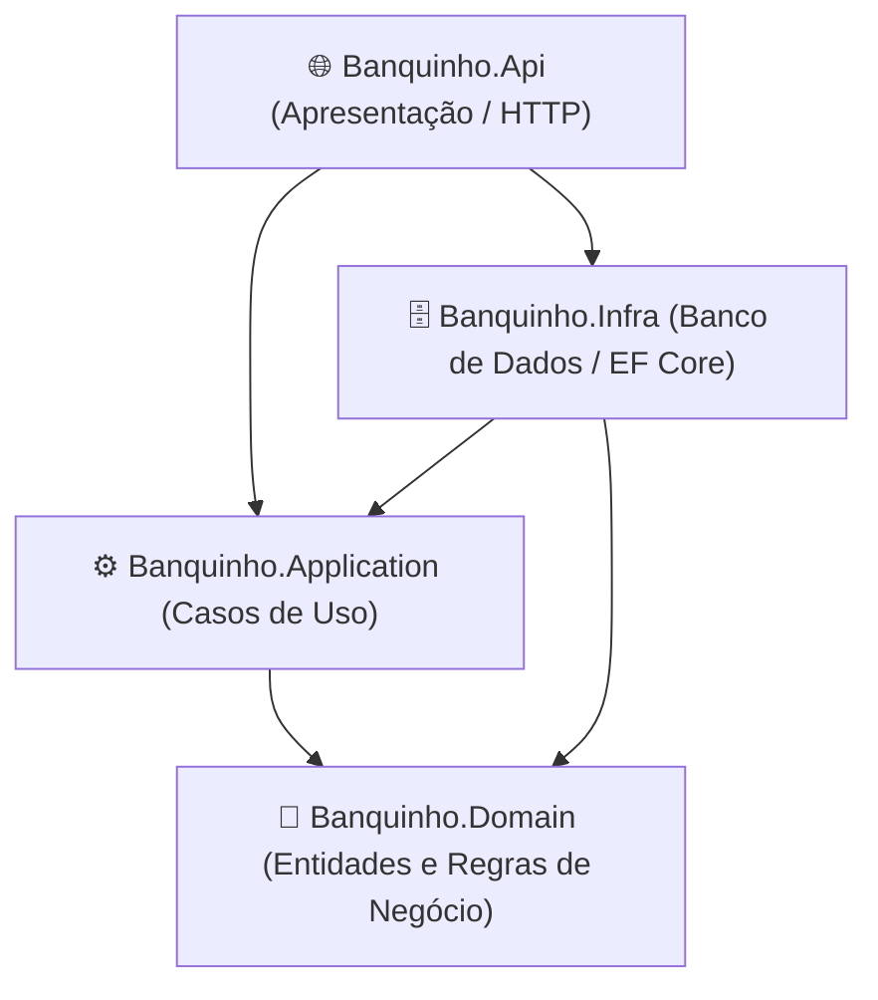
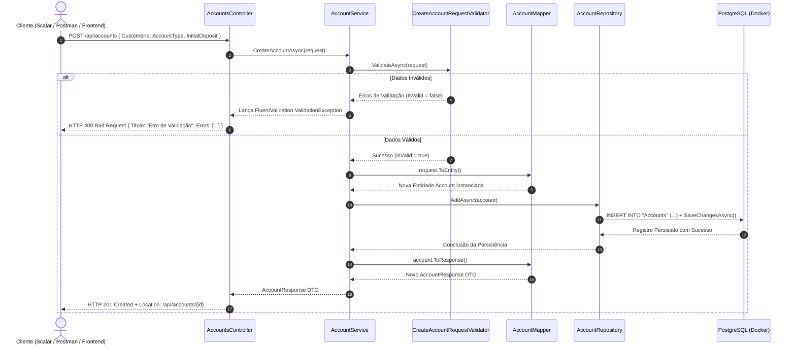
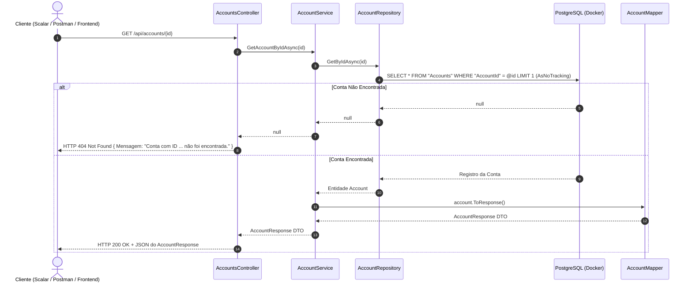

# 🏛️ Banquinho API — Arquitetura & Fluxo de Dados Ponta a Ponta

Documento técnico com o mapeamento completo da arquitetura da solução **Banquinho**, o ciclo de vida dos dados em cada requisição HTTP e o roadmap de evolução técnica.

---

## 1. 🗺️ Visão Geral da Arquitetura (Clean Architecture)

A solução é construída seguindo os princípios de **Clean Architecture** (Arquitetura Limpa), onde as regras de negócio residem no centro e as camadas externas conhecem apenas as camadas internas (Regra de Dependência).



### Papel e Responsabilidade de Cada Projeto

| Camada / Projeto | Responsabilidade Principal | O Que Contém | Dependências Externas |
| :--- | :--- | :--- | :--- |
| **`Banquinho.Domain`** | Núcleo de negócio e regras intrínsecas da aplicação. Totalmente desacoplado de banco, framework ou HTTP. | Entidades POCO (`Account`, `Customer`, `Enterprise`), Enums (`AccountType`). | *Nenhuma* (Isolamento total) |
| **`Banquinho.Application`** | Orquestração dos casos de uso, validações de entrada, conversões e contratos de serviços. | DTOs (Requests/Responses), Mappers, Validadores, Contratos (`IAccountService`, `IAccountRepository`). | `Banquinho.Domain`, `FluentValidation` |
| **`Banquinho.Infra`** | Acesso ao mundo externo e persistência de dados no banco relacional. | `BanquinhoDbContext`, Configurações Fluent API, Migrations, `AccountRepository`. | `Banquinho.Domain`, `Banquinho.Application`, `EF Core`, `Npgsql` |
| **`Banquinho.Api`** | Ponto de entrada da aplicação (Host Web). Recebe chamadas HTTP, gerencia DI e expõe documentação. | Controllers (`AccountsController`), `Program.cs`, Injeção de Dependências, OpenAPI/Scalar. | `Banquinho.Application`, `Banquinho.Infra`, `Scalar.AspNetCore` |

---

## 2. 📂 Estrutura de Diretórios e Arquivos

```
src/
├── Banquinho.Domain/
│   ├── Entities/
│   │   ├── Account.cs                     # Entidade Conta (Saldo, Número, Tipo, Chaves de Cliente)
│   │   ├── Customer.cs                    # Entidade Cliente Pessoa Física (PF)
│   │   └── Enterprise.cs                  # Entidade Empresa Pessoa Jurídica (PJ)
│   └── Enums/
│       └── AccountType.cs                 # Enum de Tipos de Conta (Corrente, Poupanca, Salario...)
│
├── Banquinho.Application/
│   ├── DTOs/
│   │   ├── Requests/
│   │   │   ├── CreateAccountRequest.cs    # Record de entrada para abertura de conta
│   │   │   └── CreateCustomerRequest.cs   # Record de entrada para cadastro de clientes
│   │   └── Responses/
│   │       └── AccountResponse.cs         # Record de saída entregue aos clientes da API
│   ├── Mappers/
│   │   └── AccountMapper.cs               # Extension Methods de conversão (ToEntity / ToResponse)
│   ├── Repository/
│   │   └── IAccountRepository.cs          # Contrato de persistência de contas
│   ├── Services/
│   │   ├── IAccountService.cs             # Contrato de casos de uso de contas
│   │   └── AccountService.cs              # Orquestrador (Valida -> Mapeia -> Salva -> Responde)
│   └── Validators/
│       ├── CreateAccountRequestValidator.cs  # Regras de negócio de validação da conta
│       └── CreateCustomerRequestValidator.cs # Regras de validação do cliente (CPF, senha, etc.)
│
├── Banquinho.Infra/
│   ├── Data/
│   │   ├── BanquinhoDbContext.cs          # Contexto EF Core com carregamento automático de configurações
│   │   └── Configurations/               # Mapeamentos Fluent API (tabelas, chaves primárias/estrangeiras)
│   │       ├── AccountConfiguration.cs
│   │       ├── CustomerConfiguration.cs
│   │       └── EnterpriseConfiguration.cs
│   ├── Migrations/                       # Histórico de versões do esquema no PostgreSQL
│   └── Repository/
│       └── AccountRepository.cs           # Implementação real de IAccountRepository via EF Core
│
└── Banquinho.Api/
    ├── Controllers/
    │   └── AccountsController.cs         # Endpoints POST /api/accounts e GET /api/accounts/{id}
    └── Program.cs                        # Configuração do Host, DI, Migrations automáticas e Scalar
```

---

## 3. 🔄 Fluxo de Dados Ponta a Ponta (End-to-End)

Abaixo está o detalhamento de como os dados trafegam pela arquitetura em cada operação.

---

### 3.1. Criação de Conta (`POST /api/accounts`)



#### Ciclo de Vida dos Dados no POST:
1. **Entrada:** O cliente HTTP envia um payload JSON.
2. **Model Binding:** O ASP.NET Core deserializa o JSON para a classe imutável `CreateAccountRequest`.
3. **Validação (Fail-Fast):** O `AccountService` executa o validador:
   - Garante exclusividade de titularidade: ou tem `CustomerId` (PF) ou `EnterpriseId` (PJ), nunca ambos ou nenhum.
   - Bloqueia conta do tipo `Salario` para empresas.
   - Exige depósito inicial de pelo menos R$ 100,00 para contas do tipo `Investimento`.
   - Impede depósitos negativos.
4. **Mapeamento de Entrada:** O método de extensão `request.ToEntity()` instancia um objeto `Account` com `Guid` novo para ID e Número da Conta, `IsActive = true` e `CreatedAt = DateTime.UtcNow`.
5. **Persistência:** O `AccountRepository.AddAsync` adiciona a entidade ao `DbSet<Account>` e executa `SaveChangesAsync()`, gerando o comando SQL `INSERT` via driver Npgsql.
6. **Mapeamento de Saída:** O método de extensão `account.ToResponse()` converte a entidade salva no DTO `AccountResponse`.
7. **Resposta:** O controller retorna `CreatedAtAction`, gerando o status `201 Created` e preenchendo o cabeçalho HTTP `Location` com a URL do endpoint de consulta.

---

### 3.2. Consulta de Conta por ID (`GET /api/accounts/{id}`)



#### Ciclo de Vida dos Dados no GET:
1. **Entrada:** O cliente chama a URL informando o `Guid` da conta na rota.
2. **Consulta Otimizada:** O `AccountRepository` executa `.AsNoTracking().FirstOrDefaultAsync(a => a.AccountId == id)`. O uso do `AsNoTracking` economiza memória e CPU ao desabilitar o rastreamento de mudanças do EF Core para leituras.
3. **Mapeamento Seguro:** Se o registro for encontrado, ele é convertido via `account?.ToResponse()`; caso contrário, retorna `null`.
4. **Tratamento HTTP:** O Controller checa se o retorno foi nulo e entrega `404 Not Found` amigável ou `200 OK` com o DTO preenchido.

---

## 4. ⭐ Pontos Fortes da Implementação Atual

* **Arquitetura Desacoplada:** O Domínio não possui qualquer dependência de banco de dados, pacotes NuGet ou detalhes de apresentação.
* **Mappers Leves com Métodos de Extensão:** A utilização de `AccountMapper` estático com `this` evita o uso de bibliotecas pesadas de reflexão (como AutoMapper) e deixa o código do serviço extremamente legível (`request.ToEntity()`, `account.ToResponse()`).
* **Validação Antecipada (Fail-Fast):** A requisição é validada antes de qualquer chamada ao banco de dados, economizando conexões e recursos.
* **Leituras Performáticas:** O repositório utiliza `.AsNoTracking()` em todas as operações de busca.
* **Migrations Automáticas:** O `Program.cs` garante que a base de dados no PostgreSQL esteja sempre atualizada no momento da inicialização via `dbContext.Database.Migrate()`.

---

## 5. ⚠️ Correções Imediatas Recomendadas

- [ ] **Ajuste de Namespace no Controller:**  
  No arquivo `src/Banquinho.Api/Controllers/AccountsController.cs`, substituir:
  ```csharp
  using System.ComponentModel.DataAnnotations;
  ```
  por:
  ```csharp
  using FluentValidation;
  ```
  Isso resolve o erro de compilação CS1061 em `ex.Errors`.

- [ ] **Tipagem no DTO de Resposta:**  
  No arquivo `src/Banquinho.Application/DTOs/Responses/AccountResponse.cs`, manter a propriedade `string AccountType` (ou o enum concreto `AccountType`) no lugar do tipo genérico `System.Enum` para garantir serialização JSON uniforme.

---

## 6. 🚀 Oportunidades de Melhoria & Evolução Técnica

Para elevar o projeto a um padrão sênior de produção, as seguintes evoluções são recomendadas:

### 1. Tratamento Global de Erros (RFC 7807 - ProblemDetails)
* **Cenário atual:** O `AccountsController` utiliza bloco `try/catch` manual para capturar `ValidationException`.
* **Melhoria:** Adicionar um `ExceptionHandlingMiddleware` global ou configurar o `AddProblemDetails()` nativo do ASP.NET Core. Assim, os Controllers ficam livres de `try/catch` e qualquer erro ou validação é padronizado automaticamente no formato RFC 7807.

### 2. Validação de Existência do Titular no Banco
* **Cenário atual:** O validador checa se o `CustomerId` tem valor, mas não verifica se o cliente existe fisicamente no banco. Se for enviado um Guid inexistente, o banco estoura uma exceção não tratada de chave estrangeira (*FK violation*).
* **Melhoria:** No `AccountService`, injetar `ICustomerRepository` e validar a existência do titular antes de criar a conta:
  ```csharp
  if (request.CustomerId.HasValue && !await _customerRepository.ExistsAsync(request.CustomerId.Value))
      throw new NotFoundException("O cliente informado não foi encontrado.");
  ```

### 3. Modelo de Domínio Rico (*Rich Domain*) vs Anêmico
* **Cenário atual:** A entidade `Account` possui propriedades com `set` público aberto (`public decimal Balance { get; set; }`). Qualquer camada pode alterar o saldo diretamente sem passar por validação.
* **Melhoria:** Proteger os setters (`private set`) e expor métodos de negócio expressivos:
  ```csharp
  public void Deposit(decimal amount)
  {
      if (amount <= 0) 
          throw new DomainException("O valor do depósito deve ser maior que zero.");
      Balance += amount;
  }
  ```

### 4. Padrão Result (Evitar Exceções para Fluxo de Controle)
* **Cenário atual:** O validador lança exceções para dados inválidos (`throw new ValidationException`).
* **Melhoria:** Em sistemas de alta performance, lançar exceções gera custo computacional de alocação de stack trace. Adotar o padrão `Result<T>` permite retornar `Result.Failure(errors)` com tipagem segura e sem impacto de performance.

### 5. Paginação e Filtros
* **Cenário atual:** Existe apenas busca por ID único.
* **Melhoria:** Implementar endpoint paginado `GET /api/accounts?pageNumber=1&pageSize=10` retornando metadados de paginação.

### 6. Testes Automatizados
* **Testes de Unidade:** Testar `AccountService` e `CreateAccountRequestValidator` isoladamente com `xUnit`, `NSubstitute` (ou `Moq`) e `FluentAssertions`.
* **Testes de Integração:** Validar o ciclo completo HTTP com `WebApplicationFactory` e `Testcontainers` para PostgreSQL.
